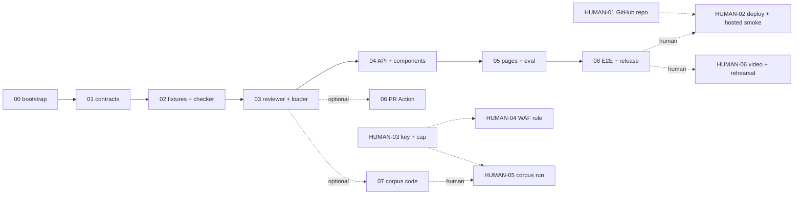

# PLAN-02 — Waves

Tasks inside a wave run in parallel (one sonnet agent each) and own disjoint files. Only WAVE-00 (T00.1) touches `package.json` / `package-lock.json`; every dependency is installed there. No code wave needs a HUMAN doc.

Rule: in a wave with more than one task, task acceptance never runs `next build`, `next start` or Playwright (except `playwright test --list`), and never shares a mutable dir such as one `.venv`. Those run only in the wave gate, because parallel tasks share one working tree, `.next/` and port 3000. Hours are human-equivalent (team capacity 48 h/week).

## Wave map

| Wave | Goal | Tasks (parallel lanes) | Depends on | Gate command | Est. h |
|---|---|---|---|---|---|
| [00](WAVE-00-bootstrap.md) | Repo, scaffold, all pinned deps, CI | T00.1 scaffold + configs + env · T00.2 CI workflow | — | `npm ci && npm run lint && npm run typecheck && npm run test:coverage && npm run build && npm run e2e && npm run format` | 8 |
| [01](WAVE-01-contracts.md) | Shared contracts | T01.1 zod schemas · T01.2 diff parser · T01.3 rate limiter | 00 | `npm run lint && npm run typecheck && npm run test:coverage && npm run build && npm run format` | 8 |
| [02](WAVE-02-fixtures-and-checker.md) | Demo fixtures + checker | T02.1 pr-1 + sabotage · T02.2 pr-2 · T02.3 pr-3 · T02.4 checker | 01 | same as 01 | 16 |
| [03](WAVE-03-reviewer-and-loader.md) | Reviewer + loader | T03.1 prompt · T03.2 Anthropic caller · T03.3 replay · T03.4 loader + ground-truth test | 02 | same + `npx tsx scripts/validate-fixtures.ts` | 12 |
| [04](WAVE-04-api-and-components.md) | API + UI parts | T04.1 review() + route · T04.2 Badge/PrList · T04.3 Matrix · T04.4 DiffView · T04.5 workspace reducer | 03 | same as 01 | 16 |
| [05](WAVE-05-pages-and-eval.md) | Pages + eval | T05.1 list page · T05.2 PR workspace · T05.3 eval + results · T05.4 record script | 04 | same + `npx playwright test e2e/smoke.spec.ts` | 16 |
| [06](WAVE-06-github-action.md) | Optional PR Action | T06.1 check-pr CLI · T06.2 workflow | 03 | same + `check-pr` on last commit | 8 |
| [07](WAVE-07-corpus-pipeline.md) | Optional corpus code (keyless) | T07.1 traj→bundle · T07.2 mischief · T07.3 issues + pins + CI | 03 | `pytest corpus/tests` + fake build + validate | 14 |
| [08](WAVE-08-e2e-deploy-release.md) | E2E + headers + smoke + release | T08.1 Playwright demo + axe · T08.2 smoke script · T08.3 security headers | 05 | full suite + `npm run e2e` + local smoke | 10 |
| | | | | **Total code waves** | **108** |

Human docs (not waves): [HUMAN-01](HUMAN-01-github-repo.md) 1 h · [HUMAN-02](HUMAN-02-vercel-deploy.md) 1 h · [HUMAN-03](HUMAN-03-anthropic-key-and-spend-cap.md) 1 h · [HUMAN-04](HUMAN-04-vercel-waf-rate-limit.md) 1 h · [HUMAN-05](HUMAN-05-corpus-run.md) 6 h · [HUMAN-06](HUMAN-06-demo-video-and-rehearsal.md) 8 h = 18 h.

## DAG

## Run order

| Goal | Workflow call |
|---|---|
| **Recommended.** Hosted MVP first; optional waves cannot block W08 | `Workflow({name:'loop-build', args:{from:0, to:5}})` then `Workflow({name:'loop-build', args:{from:8, to:8}})` |
| Optional waves later | `Workflow({name:'loop-build', args:{from:6, to:7}})` |
| Everything in order | `Workflow({name:'loop-build', args:{from:0}})` |

Critical path to a hosted demo: W00 → W01 → W02 → W03 → W04 → W05 → W08 → HUMAN-01 → HUMAN-02 = 86 h code + 2 h human ≈ 1.9 weeks at 48 h/week.
